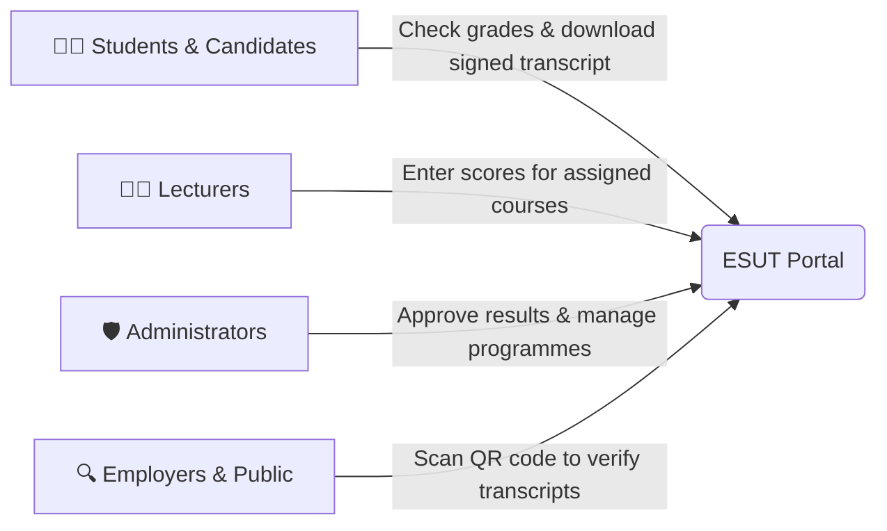

# ESUT Result Processing & Transcript Verification System
## Beginner-Friendly Quick Start & User Guide

Welcome to the **Enugu State University of Science and Technology (ESUT)** Result Processing and Official Transcript Verification Portal.

This guide explains **how the system works in simple words**, what each user role can do, and how to test the application in under 2 minutes.

---

### What Does This Application Do?

In simple terms, this platform replaces paper result sheets and slow transcript processing with a modern digital system:
1. **Lecturers** enter continuous assessment and exam scores online.
2. **Administrators** check and approve the scores.
3. **Students** can log in anytime to see their GPA/CGPA, view semester grades, and download an official signed PDF transcript.
4. **Employers, Embassies, or Other Universities** can scan the QR code on any printed transcript to instantly confirm it is authentic and hasn't been forged.

---

### The 4 Types of Users (Who Uses What?)



---

### Step-by-Step Walkthroughs

#### 1. Student / External Defence Candidate Walkthrough
> **Goal:** Check your graduation grades, see your 5.0 CGPA, and download your official PDF transcript.

1. Go to the portal login page: [http://localhost:3000/auth/login](http://localhost:3000/auth/login)
2. Click the **"🎓 M.Eng Defence"** button (or type `adaeze.akpata@pg.esut.edu.ng` and password `2024070000978`).
3. Click **"Sign In Securely"**.
4. You will arrive at the **Student Dashboard**:
   - See your Cumulative GPA (**5.00** / 5.00 — First Class Honours).
   - Click **"My Results"** on the left menu to view all 3 completed semesters and courses.
   - Click **"GPA Analytics"** to view your academic growth chart over time.
   - Click **"Official Transcript"** to view your digital academic record and click **"Download Official PDF"** to get the printable university transcript with embedded QR code.

---

#### 2. Lecturer Walkthrough
> **Goal:** View assigned departmental courses and submit student exam marks.

1. Go to: [http://localhost:3000/auth/login](http://localhost:3000/auth/login)
2. Click the **"👨‍🏫 M.Eng Lecturer"** button (or type `dr.gide@esut.edu.ng` and password `lecturer123`).
3. Click **"Sign In Securely"**.
4. You will arrive at the **Lecturer Dashboard**:
   - See your 6 assigned courses (e.g., `CEE 810`, `CEE 831`, `CEE 818`, `COE 101`, `COE 102`, `COE 401`).
   - Click **"Upload Results"** to enter scores student-by-student or drag and drop a CSV spreadsheet.
   - Click **"Submissions"** to track which scores are pending and which have been approved by the department.

---

#### 3. Administrator Walkthrough
> **Goal:** Moderate grades, approve results, and configure university programmes.

1. Go to: [http://localhost:3000/auth/login](http://localhost:3000/auth/login)
2. Click the **"🛡️ System Admin"** button (or type `admin@esut.edu.ng` and password `admin123`).
3. Click **"Sign In Securely"**.
4. You will arrive at the **Admin Overview**:
   - View university-wide statistics: total students registered, total courses, and pending result submissions.
   - Click **"Approve Results"** to review submitted score sheets and approve them with one click.
   - Click **"Courses"** or **"Programmes"** to create new courses, edit credit units, or assign lecturers to courses for any academic session.
   - Click **"Audit Logs"** to view a security history of every action taken in the system.

---

#### 4. External Verifier (Employer, Embassy, Public) Walkthrough
> **Goal:** Verify that a student actually graduated from ESUT with the grades they claim, **without needing an account**.

1. Go to the Home Page: [http://localhost:3000](http://localhost:3000) or directly to [http://localhost:3000/verify](http://localhost:3000/verify)
2. Type any student's Registration Number (e.g. `2024070000978`) and click **"Verify Transcript"**.
3. The page displays the verified university certificate card:
   - Student Full Name: **Akpata Adaeze Florence**
   - Programme: **Masters in Engineering (Computer Engineering)**
   - Cumulative GPA: **5.00** (First Class Honours / Distinction)
   - Official Verification Badge: **Record Verified Authentically**

---

### Grading Standard Used by the System

The system strictly follows the official **National Universities Commission (NUC)** and **ESUT** 5.0 grading scale:

| Score Range | Letter Grade | Grade Point | Remark |
|:---:|:---:|:---:|:---|
| **70% – 100%** | **A** | **5.0** | Excellent / Distinction |
| **60% – 69.9%** | **B** | **4.0** | Very Good |
| **50% – 59.9%** | **C** | **3.0** | Good / Pass |
| **45% – 49.9%** | **D** | **2.0** | Pass |
| **40% – 44.9%** | **E** | **1.0** | Pass |
| **0% – 39.9%** | **F** | **0.0** | Fail |

*Quality Points for each course = `Credit Units` × `Grade Point`.*  
*Semester GPA = `Total Quality Points` ÷ `Total Credit Units`.*  
*Cumulative GPA (CGPA) automatically accounts for best attempts on retaken courses.*

---

### How to Run Locally

#### 1. Backend Server
```bash
cd esut-rs
source .venv/bin/activate
uvicorn app.main:app --reload --port 8000
```
API Documentation will be live at: [http://localhost:8000/api/docs](http://localhost:8000/api/docs)

#### 2. Frontend Web Application
```bash
cd esut-transcript
npm run dev
```
Open your browser at: [http://localhost:3000](http://localhost:3000)

